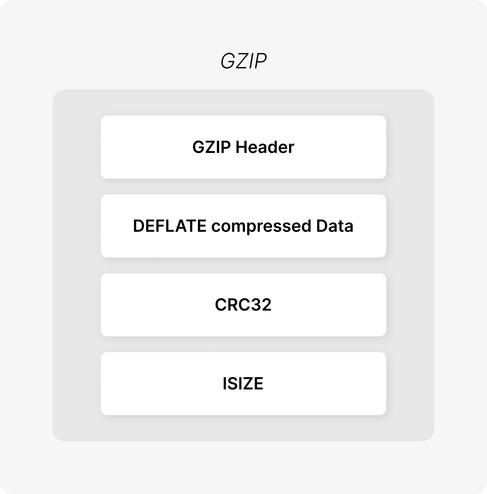
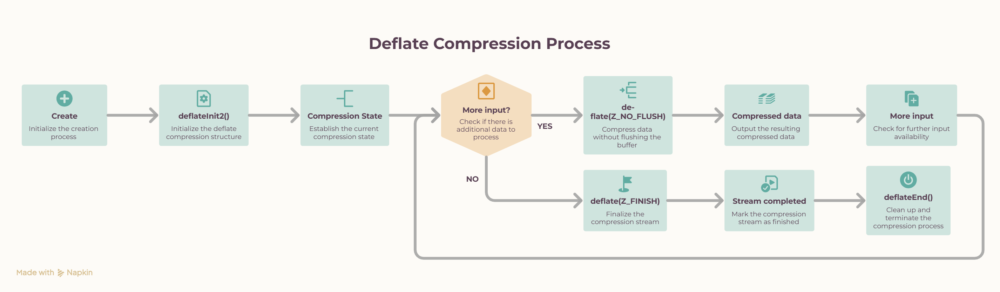

# GZIP Compression

GZIP reduces the size of data transmitted over a network. It is particularly useful for HTTP responses containing text such as HTML, CSS, JavaScript, JSON, XML, and plain text.

This guide covers GZIP, DEFLATE, zlib's streaming compression API, and how they work together in an HTTP server.

## GZIP

[GZIP](https://en.wikipedia.org/wiki/Gzip) is a file and stream format that contains **DEFLATE-compressed data** along with metadata.

{width=300}

| Component     | Description |
| ---------------- | --------------------------------------------- |
| `GZIP Header` | Identifies the data as GZIP and stores compression/metadata information. |
| `DEFLATE Compressed Data`   | The actual data compressed using the DEFLATE algorithm. |
| `CRC32` | Error-check value used to verify the integrity of the original data. |
| `ISIZE` | Size of the original uncompressed data (modulo 2³²). |


**DEFLATE** is the compression algorithm and **GZIP** is the format that wraps the compressed data.

When using zlib, the GZIP header and trailer are generated automatically.

## DEFLATE

DEFLATE combines two techniques:

1. **LZ77-style compression** - replaces repeated data with references to previously seen data.
2. **Huffman coding** - represents frequently occurring symbols using fewer bits.

For example:

```text
ABCABCABCABC
```

Instead of storing every occurrence independently, repeated sequences can be represented using references to earlier data.

These techniques work particularly well for text-based resources.


## GZIP and HTTP

A client indicates that it supports GZIP using `Accept-Encoding`:

```http
GET /sample.txt HTTP/1.1
Host: localhost:8001
Accept-Encoding: gzip
```

The server can then return:

```http
HTTP/1.1 200 OK
Content-Encoding: gzip
Content-Type: text/plain

<gzip compressed bytes>
```

`Content-Encoding: gzip` tells the client that the response body is GZIP-compressed.

## Streaming Compression

A server does not need to load an entire response into memory before compressing it.

Instead of:

```text
Read entire file
      ↓
Compress entire file
      ↓
Send response
```

streaming compression processes the response incrementally:

```text
Input chunk
    ↓
Compress
    ↓
Send
    ↓
Next chunk
    ↓
Compress
    ↓
Send
    ...
```

The compressor maintains its state between chunks, allowing large responses to be processed without holding the entire response in memory.


## Compression Lifecycle

A streaming GZIP compressor follows this lifecycle:



The important point is that `deflateInit2()` is called once. The same `z_stream` is then reused across multiple calls to `deflate()`.

```text
deflateInit2()
      ↓
   Input
      ↓
deflate(Z_NO_FLUSH)
      ↓
   Output
      ↓
   More input
      ↓
deflate(Z_NO_FLUSH)
      ↓
   ...
      ↓
Input closes
      ↓
deflate(Z_FINISH)
      ↓
Z_STREAM_END
      ↓
deflateEnd()
```

---

# zlib

[zlib](https://zlib.net/) is a C library that provides compression and decompression functionality.

Include zlib with:

```c
#include <zlib.h>
```

On Debian or Ubuntu:

```bash
sudo apt install zlib1g-dev
```

When compiling:

```bash
gcc main.c -lz
```

The `-lz` option links the program with zlib.


## zlib Compression API

### 1. `deflateInit2()`

```c
int deflateInit2(
    z_streamp strm,
    int level,
    int method,
    int windowBits,
    int memLevel,
    int strategy
);
````

`deflateInit2()` initializes a DEFLATE compression stream and allocates the internal state required by subsequent `deflate()` calls.

#### Important Parameters

| Parameter    | Purpose                                                                                                 |
| ------------ | ------------------------------------------------------------------------------------------------------- |
| `strm`       | Pointer to the `z_stream` structure that stores compression state.                                      |
| `level`      | Controls the compression level. Values range from `-1` to `9`.                                          |
| `method`     | Specifies the compression method. Use `Z_DEFLATED`.                                                     |
| `windowBits` | Controls the DEFLATE window size and wrapper format.                                                    |
| `memLevel`   | Controls the amount of memory used by the compressor. Values range from `1` to `9`; `8` is the default. |
| `strategy`   | Controls the compression strategy. `Z_DEFAULT_STRATEGY` is suitable for general-purpose data.           |

#### `level`

Controls the trade-off between compression ratio and compression speed:

| Value | Meaning                                                      |
| ----- | ------------------------------------------------------------ |
| `-1`  | Use the default compression level (`Z_DEFAULT_COMPRESSION`). |
| `0`   | No compression; data is stored.                              |
| `1`   | Fastest compression with lower compression ratio.            |
| `1–8` | Increasing compression effort.                               |
| `9`   | Maximum compression effort; generally slower.                |

The implementation accepts:

```c
-1 <= level <= 9
```

#### `method`

Specifies the compression algorithm.

```c
Z_DEFLATED
```

is the standard DEFLATE compression method supported by zlib.

#### `windowBits`

Controls both the DEFLATE sliding-window size and the wrapper format.

```text
 MAX_WBITS       → zlib-wrapped DEFLATE
-MAX_WBITS       → raw DEFLATE
 MAX_WBITS + 16  → GZIP-wrapped DEFLATE
```

The implementation uses:

```c
16 + MAX_WBITS
```

to produce a **GZIP-wrapped DEFLATE stream**.

#### `memLevel`

Controls how much memory zlib uses internally.

```text
1 → lower memory usage
8 → default
9 → higher memory usage
```

Higher values can improve performance for some workloads but require more memory.

#### `strategy`

Controls how zlib searches for compression opportunities.

Common strategies include:

```text
Z_DEFAULT_STRATEGY → General-purpose compression
Z_FILTERED         → Data produced by filters/predictors
Z_HUFFMAN_ONLY     → Huffman coding without string matching
Z_RLE               → Run-length encoding oriented
Z_FIXED             → Use fixed Huffman codes
```

For general HTTP response data, the implementation uses:

```c
Z_DEFAULT_STRATEGY
```

#### Return Value

`deflateInit2()` returns a status code indicating whether the compression stream was initialized successfully.

| Return Value      | Meaning                                                                        |
| ----------------- | ------------------------------------------------------------------------------ |
| `Z_OK`            | Compression stream initialized successfully.                                   |
| `Z_MEM_ERROR`     | Insufficient memory to initialize the compressor.                              |
| `Z_STREAM_ERROR`  | One or more parameters are invalid.                                            |
| `Z_VERSION_ERROR` | The zlib version is incompatible with the version expected by the application. |

#### When Can These Errors Occur?

**`Z_MEM_ERROR`**

Occurs when zlib cannot allocate the memory required for the compression state.

```text
deflateInit2()
      ↓
memory allocation fails
      ↓
Z_MEM_ERROR
```

**`Z_STREAM_ERROR`**

Occurs when an invalid parameter is supplied, such as an invalid compression level, method, or configuration.

```text
invalid parameter
      ↓
deflateInit2()
      ↓
Z_STREAM_ERROR
```

**`Z_VERSION_ERROR`**

Occurs when the zlib version available at runtime is incompatible with the version expected by the application.

```text
incompatible zlib version
      ↓
deflateInit2()
      ↓
Z_VERSION_ERROR
```

#### Example

```c
if (deflateInit2(
        &gzip->stream,
        level,
        Z_DEFLATED,
        16 + MAX_WBITS,
        8,
        Z_DEFAULT_STRATEGY
    ) != Z_OK) {

    logger(LOG_ERROR,
           "xps_gzip_create()",
           "deflateInit2() failed");

    /* Cleanup */
    ...
}
```

The stream must be successfully initialized before calling `deflate()`.


### 2. `deflate()`

```c
int deflate(z_streamp strm, int flush);
```

`deflate()` performs the actual compression.

Before calling it, configure the input and output fields of `z_stream`:

```c
stream.next_in   = input;
stream.avail_in = input_length;

stream.next_out  = output;
stream.avail_out = output_size;
```

#### `z_stream`

The same `z_stream` is reused throughout the compression process.

The four important fields are:

| Field       | Purpose                              |
| ----------- | ------------------------------------ |
| `next_in`   | Pointer to the next input byte       |
| `avail_in`  | Number of input bytes available      |
| `next_out`  | Pointer to the output buffer         |
| `avail_out` | Space remaining in the output buffer |

After `deflate()` returns, zlib updates `avail_in` and `avail_out` to reflect the data consumed and produced.

For example:

```text
Output buffer = 4096 bytes
avail_out     = 3000 bytes

Compressed output = 4096 - 3000
                   = 1096 bytes
```

#### Flush modes

The implementation primarily uses:

```c
Z_NO_FLUSH
```

while more input is expected, and:

```c
Z_FINISH
```

when no more input remains.

Other modes include `Z_SYNC_FLUSH` and `Z_FULL_FLUSH`, but they are not required for normal streaming compression here. These are explained below

#### Return values

* `Z_OK` — compression is progressing
* `Z_STREAM_END` — compression has finished
* `Z_STREAM_ERROR` — invalid stream state
* `Z_BUF_ERROR` — zlib could not make progress with the supplied buffers

---

# `Z_NO_FLUSH`

```c
deflate(&stream, Z_NO_FLUSH);
```

`Z_NO_FLUSH` is used while more input is expected.

```text
Input chunk
    ↓
Z_NO_FLUSH
    ↓
Compressed output
    ↓
Input chunk
    ↓
Z_NO_FLUSH
    ↓
Compressed output
    ↓
...
```

The same `z_stream` is reused for every chunk, allowing zlib to maintain compression state across the stream.

---

# `Z_FINISH`

```c
deflate(&stream, Z_FINISH);
```

`Z_FINISH` is used when no more input will be supplied. It tells zlib to finish the stream and produce any remaining compressed data.

A successful completion eventually returns:

```c
Z_STREAM_END
```

This is different from `deflateEnd()`:

```text
Z_FINISH
    ↓
Complete the compressed stream

deflateEnd()
    ↓
Release zlib resources
```

---

# `deflateEnd()`

```c
int deflateEnd(z_streamp strm);
```

`deflateEnd()` releases the resources associated with the compression stream.

It should be called after compression has been completed:

```text
deflateInit2()
      ↓
deflate(..., Z_NO_FLUSH)
      ↓
More input
      ↓
deflate(..., Z_NO_FLUSH)
      ↓
Input closes
      ↓
deflate(..., Z_FINISH)
      ↓
Z_STREAM_END
      ↓
deflateEnd()
```

---

# Complete Compression Flow

```text
             xps_gzip_create()
                    ↓
              deflateInit2()
                    ↓
               z_stream
                    ↓
              Input arrives
                    ↓
          gzip_sink_handler()
                    ↓
           gzip_compress()
                    ↓
              deflate()
                    ↓
          Compressed output
                    ↓
           transfer_buff
                    ↓
        gzip_source_handler()
                    ↓
             Send downstream
                    ↓
             More input?
             /          \
           YES           NO
            │             │
            │         Z_FINISH
            │             │
            │       Final output
            │             │
            └───────┬─────┘
                    ↓
               deflateEnd()
```

The key idea is simple: **initialize the stream once, feed it input in chunks, finish it when the input closes, and then release its resources.**
